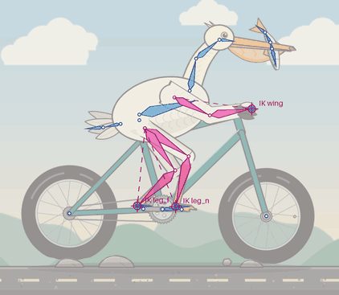

# open-game-skills

<p align="center">
  
</p>

<p align="center">
  <a href="README.md">English</a> · <a href="README.zh.md">简体中文</a> · <a href="README.zh-Hant.md">繁體中文</a> · <a href="README.ja.md">日本語</a> · <b>한국어</b>
</p>

<p align="center">
  <strong>게임 제작용 범용 Agent Skill.</strong><br/>
  평소처럼 말하면 dispatcher가 skill과 열을 고른다.
</p>

<p align="center">
  <a href="https://github.com/jammyfu/open-game-skills/actions/workflows/skill-quality.yml"></a>
  <a href="LICENSE"></a>
  <a href="https://github.com/jammyfu/open-game-skills/stargazers"></a>
  <a href="skills/catalog.json"></a>
  <a href="skills/SKILL.md"></a>
  
  <a href="https://jammyfu.github.io/open-game-skills/weighted-skinning/"></a>
  
</p>

기본 문서는 [English README](README.md).

## 스타할 만한 이유

- **194개 게임 스킬, 하나의 디스패처.** 게임을 평소 말로 설명하면 에이전트가 단계마다 최대 3개 스킬과 1개 엔진 어댑터를 불러옵니다.
- **엔진 중립.** three.js, PixiJS, Phaser, Cocos, Godot, Unity, Unreal과 자체 런타임을 지원합니다.
- **테스트 가능한 규칙.** 모든 스킬에 일반·경계·적대 리뷰 사례가 있고 CI가 검사합니다.
- **실제로 쓰는 2D 스키닝 도구.** 메시, 조화 웨이트, 번짐·이음새 검사, IK 트레이스, 접힘·늘어남 감사, Spine 스타일 본 오버레이, 검증된 rig-c 내보내기. Python, numpy, Pillow만 필요합니다.
- **지금 쓰는 도구에서 바로.** Claude Code, Codex, Cursor, OpenClaw 등 `SKILL.md`를 읽는 모든 에이전트.

## 직접 보기: 자전거 타는 펠리컨

<p align="center"></p>

<table>
  <tr>
    <td align="center" width="33%"><br/><sub>본과 IK 제약</sub></td>
    <td align="center" width="33%"><br/><sub>부리에 가로로 문 물고기</sub></td>
    <td align="center" width="33%"><br/><sub>돌 위에서 눌리는 타이어</sub></td>
  </tr>
</table>

생성된 캐릭터 하나, 레이어 27개, 다운로드 없음. 모든 움직임은 본과 스킨 웨이트로 만듭니다:

- **날개로 핸들 잡기.** 2본 IK로 몸이 스프링 위에서 흔들려도 오차 2e-14 이내.
- **페달 위의 다리.** 본 길이 고정, 무릎은 44°에서 114°까지 굽고 접히지 않습니다.
- **가로로 문 물고기.** 4개 본이 무는 지점에서 시작해 양끝이 퍼덕이고, 닫힌 부리가 몸통 가운데를 가립니다.
- **부드러운 타이어.** 안쪽은 림에 고정되고, 트레드는 도로와 돌에 닿는 곳만 눌립니다.
- **목, 머리, 꼬리.** 매끄러운 목, 페달 박자에 맞춰 흔들리는 머리, 2본 꼬리의 떨림.
- **증거로 보여 줍니다.** 조화 웨이트의 가시 접힘 픽셀은 0. 최근접 본 강체 대조군은 접혀서 거부됩니다.

    python -m pip install -r requirements-dev.txt
    python examples/pelican-bicycle/run.py --out /tmp/pelican-review

[사례 읽기](examples/pelican-bicycle/README.md) · [skin-weights Skill](skills/2d/skin-weights/SKILL.md)

### 더 많은 실행 사례

- **관절 웨이트, 실패와 수정.** 같은 원화와 본에서 수정 전 2,529개 가시 접힘 픽셀, 수정 후 0. [데모](https://jammyfu.github.io/open-game-skills/weighted-skinning/) · [재현 방법](examples/weighted-skinning/README.md)
- **바인딩 전 아틀라스 번짐.** 픽셀이 같은 잘라내기도 옆 부품의 색을 가져올 수 있습니다. [재현](examples/attachment-ownership/README.md) · [그림 설명](docs/cases/attachment-ownership.md)

[](https://jammyfu.github.io/open-game-skills/weighted-skinning/)

## 먼저 말하기

[`skills/SKILL.md`](skills/SKILL.md) → [`dispatcher`](skills/dispatcher/SKILL.md).

```text
USE:
- <skill> / <모드>
ENGINE: none | unknown | custom | threejs | pixijs | phaser | cocos | godot | unity | unreal
ASK: <필요한 질문 하나 또는 빈칸>
DEFER: <후속 단계 또는 빈칸>
```

단계마다 전문 skill 최대 3개(에셋/2D 포함)와 필요한 engine 1개를 읽습니다. 나머지는 DEFER에 기록하고 다음 단계에서 처리합니다. `none`은 설계 작업이라 engine이 필요 없다는 뜻이고, `unknown`은 미확정, `custom`은 실제 사용자 정의 런타임을 뜻합니다. 추측으로 custom을 선택하지 않습니다.

역할과 검증 범위는 [공통 실행 규칙](skills/CONTRACT.md)을 참고하세요. [자동 생성된 전체 목록](skills/catalog.json)에는 모든 skill이 있습니다. 예시 표에는 주요 항목만 표시합니다.

| 말 | 불러야 할 것 |
|---|---|
| 스트리트 파이터식 3D | `fighting-design` / grounded-footsies · `action-feel` / short-special |
| 퀘스트 화살표 없는 오픈월드 | `world-map` · `camera-anti-clip` |
| 점프가 붕 뜬다 | `platform-jump` · `jump-leniency` |
| 처음 하는 사람도 클리어할 수 있는가 | `gameplay-validation` / real-input |
| 히트스턴이 너무 길다 | `hitstun-recover` · `enemy-kit-balance` |
| 컷씬 후 조작을 돌려줄 것 | `cutscene-handoff` |
| 낮은 각도로 사적 영역을 침범하는 프레이밍 | `camera-modesty` / modest |

## 엔진 어댑터

[custom](skills/engines/custom/SKILL.md) · [threejs](skills/engines/threejs/SKILL.md) · [pixijs](skills/engines/pixijs/SKILL.md) · [phaser](skills/engines/phaser/SKILL.md) · [cocos](skills/engines/cocos/SKILL.md) · [godot](skills/engines/godot/SKILL.md) · [unity](skills/engines/unity/SKILL.md) · [unreal](skills/engines/unreal/SKILL.md)

## 철칙

1. 히트스톱 ≠ 히트스턴. 유리 프레임 = 상대의 첫 행동 가능 tick − 자신의 첫 행동 가능 tick.
2. 플레이어 i-frame이나 스턴을 후려 적을 밸런스하지 말 것.
3. 텔레포트/잠금 해제/디버그는 자연 클리어가 아니다.
4. 결제와 외형은 캔슬 창이나 허트박스를 바꾸지 않는다.
5. 완성 스테이지나 프레임 테이블을 규칙에 넣지 말 것.

목록은 [English README](README.md).

## 설치

```bash
git clone https://github.com/jammyfu/open-game-skills.git
cd open-game-skills
python3 tools/install.py --target "$HOME/.openclaw/workspace/skills"
python3 tools/install.py --target "$HOME/.claude/skills"
```

위 경로는 예시입니다. 실제 Agent skills 디렉터리를 지정하세요. 기존 파일이나 다른 링크를 덮어쓰지 않습니다. `--dry-run`으로 확인하고, 필요하면 `--copy`를 사용하세요. 복사본 업데이트는 수동입니다. Python 3.10+가 필요합니다. Windows에서는 `python`과 명시적인 경로를 사용하세요. 각 Agent의 자동 검색은 별도 검증이 필요합니다.

## 기존 설치 업데이트

저장소 디렉터리에서 실행하세요. 먼저 커밋하지 않은 변경 사항을 커밋하거나 별도로 보관하세요. 브랜치가 갈라졌다면 차이를 조정하고 강제로 초기화하지 마세요.

```bash
git switch main
git pull --ff-only origin main
```

심볼릭 링크 설치는 업데이트된 소스를 바로 참조합니다. `--copy`로 설치했다면 기존 설치 디렉터리를 명시적으로 백업하거나 옮긴 뒤 다시 복사하세요. 설치 프로그램은 덮어쓰지 않습니다. 이 작업은 게임을 업데이트하거나 Agent 설정을 변경하지 않습니다.

## 개발 검사

가상 환경에서 Python 3.10+를 사용하고 저장소 루트에서 실행하세요. Windows에서는 예시의 `python3`를 `python`으로 바꾸세요.

```bash
python3 -m pip install -r requirements-dev.txt
python3 -m unittest discover -s tests -v
python3 tools/skill_quality.py --check-catalog
```

skill을 추가, 삭제하거나 이름을 바꾼 뒤 목록을 다시 생성하고 테스트를 다시 실행하세요.

```bash
python3 tools/skill_quality.py --write-catalog --check-catalog
```

이 검사는 메타데이터, 로컬 참조, 목록 일관성, 설치 프로그램 동작, 다국어 README의 공통 정보를 확인합니다. LLM 라우팅 정확도, engine 호환성, 사람이 실제로 플레이할 수 있는지, 번역 품질을 보장하지 않습니다. 범위는 [기여 안내](CONTRIBUTING.md)를 참고하세요. 나머지 skill의 상세 검토는 아직 완료되지 않았습니다.

## 엔지니어링 스킬

각 스킬에 설정 예제와 정상·경계·오용 유도 평가 사례가 있습니다. 사례 작성은 실제 평가 완료를 의미하지 않습니다.

| Skill | 담당 범위 |
|---|---|
| [game-state-flow](skills/disciplines/game-state-flow/SKILL.md) | 게임 전체 상태 전환, 만료된 비동기 작업, 중복 없는 결과 확정. |
| [asset-runtime](skills/disciplines/asset-runtime/SKILL.md) | 리소스 로딩, 공유 참조, 취소 및 해제. |
| [procedural-generation](skills/disciplines/procedural-generation/SKILL.md) | 생성 버전, 진행 경로 도달성, 횟수가 제한된 복구. |
| [terrain-surface](skills/disciplines/terrain-surface/SKILL.md) | 청크 경계, 경사, 물가와 충돌 형상의 일치. |
| [world-streaming](skills/disciplines/world-streaming/SKILL.md) | 셀 준비 상태, 상주 관리, 이동과 변경 데이터 저장. |
| [physics-interaction](skills/disciplines/physics-interaction/SKILL.md) | 밀기, 들기, 던지기와 물리 제어 소유권. |

[조합 워크플로](skills/references/engineering-workflow.md) · [전용 레지스트리](skills/engineering-registry.json) · [평가 기록](docs/EVALUATION.md)

```bash
python3 tools/engineering_quality.py
```

레지스트리는 이 여섯 스킬만 다룹니다. 이 명령은 구조와 가져온 기록의 일관성을 검사하며 모델을 호출하지 않습니다. 실제 결과가 없으면 18개 사례 모두 `not-run`입니다. 정적 검사 통과는 모델 동작이나 엔진 구현의 통과를 뜻하지 않습니다.

MIT. by jammyfu / PaintingCoder

## 테스트는 기존 공개 에셋부터 사용

[open-asset-fixture](skills/assets/open-asset-fixture/SKILL.md)로 2D, 3D, 애니메이션, 사운드, VFX, PBR, HDRI 테스트 입력을 준비합니다. [출처와 라이선스](skills/assets/open-asset-fixture/reference/sources.md), [사용법과 상태](skills/assets/open-asset-fixture/reference/usage.md)를 확인하세요. 요구사항에 맞고 해시가 검증된 로컬 파일을 먼저 재사용하고, 다음으로 무료 CC0 후보를 찾습니다. CC-BY는 저작자 표시 조건에 대한 명시적 동의가 필요합니다. 스크립트가 다운로드, 구매 또는 생성 모델 호출을 자동으로 실행하지는 않습니다.

```sh
python3 skills/assets/open-asset-fixture/scripts/prepare_assets.py --skill materials
python3 skills/assets/open-asset-fixture/scripts/prepare_assets.py --all-skills skills/catalog.json --output asset-plan.json
python3 skills/assets/open-asset-fixture/scripts/prepare_assets.py --skill juice-vfx --root /absolute/fixtures --locks /absolute/fixture.lock.json --pinned-only
```

정의되지 않은 요구사항은 `needs-requirements`로 남습니다. `--pinned-only`는 오프라인 CI용이며, 필요한 파일이 없으면 테스트를 차단합니다. `needs-acquisition`은 후보만 찾은 상태이고 `ready-for-import`도 디코딩이나 엔진 테스트 통과를 뜻하지 않습니다. TheLegendOfTrump는 별도로 허용된 소재에만 사용하며, 미완성 게임 구현을 정답으로 삼거나 CC0로 분류하지 않습니다.

## 에셋 팩

완성된 장르별 에셋 팩(아틀라스, 타일셋, Tiled 맵, 조작감·오디오 데이터. `pack.json`으로 기술)을 받았다면 [asset-pack-intake](skills/assets/asset-pack-intake/SKILL.md)를 사용합니다. 매니페스트를 검증하고, 각 폴더를 담당 스킬에 연결하며, 엔진 빌드 단계를 계획합니다. 아트는 수정하지 않습니다. [매니페스트 계약](skills/assets/asset-pack-intake/reference/pack-manifest.md)은 범용이며 특정 생성기에 묶이지 않습니다.

```sh
python3 skills/assets/asset-pack-intake/scripts/validate_pack.py --root /absolute/pack --plan --engine godot --style pixel-16bit
```

검사는 정적입니다(해시, 아틀라스 사각형과 PNG 크기, 맵 gid, 조작감 수치의 출처, 팩 안에 코드가 없는지, 각 스타일이 선언한 1080p 정수 배율 캔버스, 모든 에셋 키를 모든 스타일에 연결하는 `styles.json` 전환 표). 엔진 가져오기, 클리어, 청감은 증거가 나올 때까지 `not-run`으로 둡니다.

## 제작 실무 기능 확장

모듈식 장면 조립, 리그 간 클립 호환성, 실루엣 보존 LOD, 그래픽 리소스 복구, 리플레이 최초 차이 진단을 추가하거나 강화했습니다. [기능 가이드](docs/PRACTICAL-CAPABILITIES.md)를 참고하세요. 오프라인 도구는 선언된 배치와 내보낸 트레이스만 검사하며 게임 실행이나 LLM 성능 향상을 입증하지 않습니다.

[scene-assembly](skills/disciplines/scene-assembly/SKILL.md) · [character-rig](skills/assets/character-rig/SKILL.md) · [model-pipeline](skills/assets/model-pipeline/SKILL.md) · [asset-runtime](skills/disciplines/asset-runtime/SKILL.md) · [gameplay-harness](skills/disciplines/gameplay-harness/SKILL.md)

### HD 스프라이트 시퀀스

[hd-sprite-sequence](skills/2d/hd-sprite-sequence/SKILL.md): 얼굴 크기와 신체 비율을 고정하고 이미지 해시, 독립 랜드마크, 루프 연속성을 검증합니다.

고정 파츠와 뼈대로 프레임을 베이크하며 프레임별 크기 변경이나 얼굴 교체를 금지합니다. 독립적인 이미지 및 동작 검증은 여전히 필요합니다.
