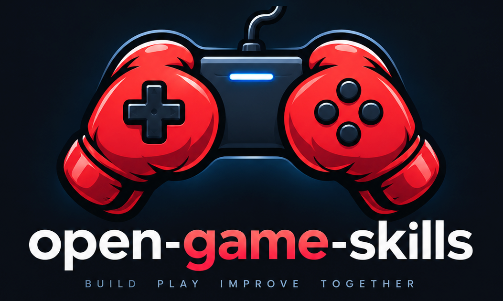
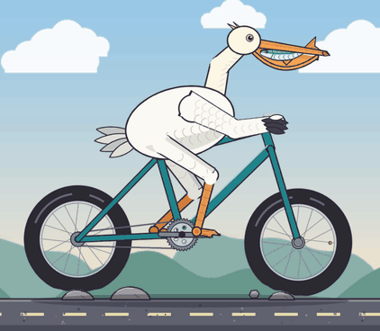
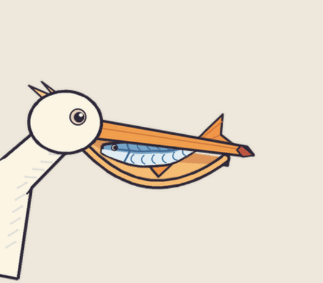
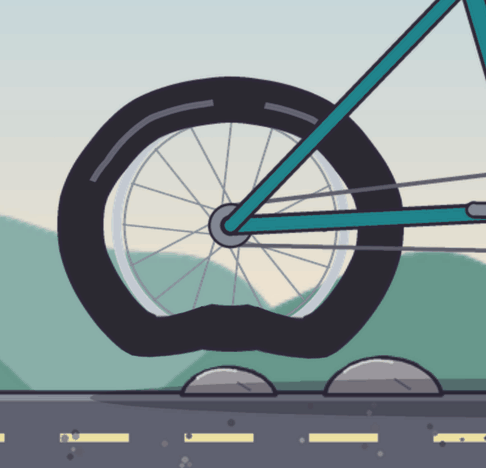

# open-game-skills

<p align="center">
  
</p>

<p align="center">
  <b>English</b> · <a href="README.zh.md">简体中文</a> · <a href="README.zh-Hant.md">繁體中文</a> · <a href="README.ja.md">日本語</a> · <a href="README.ko.md">한국어</a>
</p>

<p align="center">
  <strong>Generic agent skills for making games.</strong><br/>
  Speak normally. The dispatcher picks skills and columns.<br/>
  Studios and engines are columns you stack — not games you clone.
</p>

<p align="center">
  <a href="https://github.com/jammyfu/open-game-skills/actions/workflows/skill-quality.yml"></a>
  <a href="LICENSE"></a>
  <a href="https://github.com/jammyfu/open-game-skills/stargazers"></a>
  <a href="skills/catalog.json"></a>
  <a href="skills/SKILL.md"></a>
  
  <a href="https://jammyfu.github.io/open-game-skills/weighted-skinning/"></a>
  
</p>

Open-source skill cluster for OpenClaw, Claude Code, Codex, Cursor, and anything that reads `SKILL.md`.

## See an executable case

**Catch broken skinning before it ships.** Inspect a real PixiJS joint, compare rejected and revised weights, then reproduce the pixel-aware audit.

[](https://jammyfu.github.io/open-game-skills/weighted-skinning/)

**[Play the live demo →](https://jammyfu.github.io/open-game-skills/weighted-skinning/)** · [Run the case](examples/weighted-skinning/README.md) · [Read the Skill](skills/2d/spine-skeletal/SKILL.md)

    python -m pip install -r requirements-dev.txt
    python examples/weighted-skinning/run.py --out /tmp/weighted-skin-review

Same source and fixed bones: the narrow envelope fails with **2,529 visible fold pixels**; the revised envelope passes with **0**. The [HD sequence harness](skills/2d/hd-sprite-sequence/SKILL.md) adds independent identity, proportion and frame/loop checks. This case validates a limb workflow; full-character and gameplay acceptance remain separate.

**Pelican on a bicycle: weights that survive IK and bumps.** A pelican pedals down a road with a fish flopping in its beak. The fish has a four-bone spine, the tyres are soft rings that squash over stones, and the legs follow the pedals through two-bone IK. Harmonic weights pass lint and the fold audit with 0 folded pixels; rigid nearest-bone weights fold both tyres, both knees and the fish and are rejected. 26 generated layers, no downloads. [Run the case](examples/pelican-bicycle/README.md) · [Read the Skill](skills/2d/skin-weights/SKILL.md)

<p align="center"></p>

<p align="center">
  
  
</p>

    python examples/pelican-bicycle/run.py --out /tmp/pelican-review

**Catch atlas bleed before binding:** [reproduce a pixel-identical crop that copies neighbouring paint](examples/attachment-ownership/README.md), then verify owner-only exports with the [native ownership audit](skills/2d/spine-skeletal/scripts/audit_attachment_ownership.py). [See the visual case](docs/cases/attachment-ownership.md).

## Speak first

Install the pack. Point the agent at [`skills/SKILL.md`](skills/SKILL.md). It loads [`dispatcher`](skills/dispatcher/SKILL.md) and answers in this shape:

```
USE:
- <skill> / <column>
ENGINE: none | unknown | custom | threejs | pixijs | phaser | cocos | godot | unity | unreal
ASK: <one necessary question or empty>
DEFER: <later phases or empty>
```

You do not name files. At most three specialized skills (including assets/2D) plus one necessary engine per phase. Continue with deferred work. `none` means design-only work needs no engine; `unknown` means unresolved; `custom` means an actual custom runtime, not a guessed default.

Read the [shared contract](skills/CONTRACT.md) for scope and evidence rules. The [complete generated catalog](skills/catalog.json) lists every skill; the tables below are highlights, not the full inventory.

| You say | Agent should load |
|---|---|
| Capcom-like 3D fighter | `fighting-design` / grounded-footsies · `action-feel` / short-special · `kb-mouse-map` / fighter-plane |
| Open world, no quest arrows | `world-map` / open-air · `camera-anti-clip` / orbit-third |
| Jump feels floaty | `platform-jump` · `jump-leniency` |
| Can a stranger finish this? | `gameplay-validation` / real-input |
| Stun is too long / elite has no punish | `hitstun-recover` · `enemy-kit-balance` |
| Cutscene should give the stick back | `cutscene-handoff` |
| Invasive low-angle character framing | `camera-modesty` / modest |
| Moving platform + lava | `moving-platform` · `hazard-volume` |
| Branching dialogue | `dialogue-flags` |
| Rhythm timing / deckbuilder | `rhythm-judge` or `deck-build` |

## How it stacks

```
engine adapter     custom / three.js / PixiJS / Phaser / Cocos / Godot / Unity / Unreal
        ↓
discipline         feel · kit · traversal · camera · world · validate …
        ↓
one column         short-special · consume · drift-kart · region-tier …
```

One combat clock per actor. One wear column per item. A studio name only picks columns.

Engine adapters bind six primitives: `poll_input` · `now_logical_frame` · `play_pose` · `query_hits` · `apply_knockback` · `juice_hook`.

## Iron laws

1. **Hitstop ≠ hitstun.** Hitstop freezes both colliding clocks. Hitstun is what the victim cannot do after that. Advantage = victim first-action tick − attacker first-action tick. Stun minus remaining recovery is only the equal-clock special case.
2. **Do not balance a monster by stealing player i-frames or stretching player stun.** Tune tell, recover, cooldown, then damage, then HP.
3. **A teleported / unlocked / debug session is not a natural clear.** Label it.
4. **IAP and cosmetics do not change cancel windows or hurtboxes.**
5. **Do not copy a finished stage or frame table into the rules.** Columns only.

Frame windows and accept tests live in each `SKILL.md`.

## Catalog highlights (one line each)

### Feel & clock

| Skill | What it is for |
|---|---|
| [action-feel](skills/disciplines/action-feel/SKILL.md) | Buffer, cancel, hitstop, and the combat clock. Ask the column first. |
| [combo-design](skills/disciplines/combo-design/SKILL.md) | Confirm routes and decay. Infinite stun is a bug. |
| [hitstun-recover](skills/disciplines/hitstun-recover/SKILL.md) | How long the victim cannot act after hitstop ends. |
| [knockback-launch](skills/disciplines/knockback-launch/SKILL.md) | Pop-up and launch tables, not a second gravity. |
| [knockback-body](skills/disciplines/knockback-body/SKILL.md) | Sweep the walk capsule so a launch does not embed in a wall. |
| [landing-lag](skills/disciplines/landing-lag/SKILL.md) | Grounded recover after an aerial. Empty hop is short; attack land is long. |
| [juice-vfx](skills/disciplines/juice-vfx/SKILL.md) | Flash and shake after the logical hit, never instead of it. |
| [audio-feel](skills/disciplines/audio-feel/SKILL.md) | Beds and one-shots on the same clock. Retry must not stack the old track. |
| [haptic-rumble](skills/disciplines/haptic-rumble/SKILL.md) | Pad rumble on the juice beat. Off must not change windows. |
| [super-meter](skills/disciplines/super-meter/SKILL.md) | Super / burst as a published bar. It does not silently rewrite hitstop. |

### Combat kit

| Skill | What it is for |
|---|---|
| [fighting-design](skills/disciplines/fighting-design/SKILL.md) | Neutral, space, and grounded-footsies vs air-juggle columns. |
| [enemy-kit-balance](skills/disciplines/enemy-kit-balance/SKILL.md) | One job per body. Tune tell and punish before HP. |
| [attack-tell](skills/disciplines/attack-tell/SKILL.md) | Startup the player can read. A flash is never the only warning. |
| [hyper-armor](skills/disciplines/hyper-armor/SKILL.md) | Armor as data on the move, after the tell. |
| [parry-guard](skills/disciplines/parry-guard/SKILL.md) | Block and parry windows as move rows. |
| [dodge-iframe](skills/disciplines/dodge-iframe/SKILL.md) | I-frames live on the dodge row, not as a hidden global. |
| [throw-tech](skills/disciplines/throw-tech/SKILL.md) | Grab vs strike. A throw box is not a punch box. |
| [wakeup-oki](skills/disciplines/wakeup-oki/SKILL.md) | Knockdown and get-up options. Infinite down is a bug. |
| [boss-design](skills/disciplines/boss-design/SKILL.md) | Phases swap jobs. A phase is not silent extra damage. |
| [hitbox-hurtbox](skills/disciplines/hitbox-hurtbox/SKILL.md) | Strike vs hurt vs grab volumes on the logic tick. |
| [collision-layers](skills/disciplines/collision-layers/SKILL.md) | Who hits whom. The render mesh is not the hurtbox. |

### Traversal

| Skill | What it is for |
|---|---|
| [locomotion](skills/disciplines/locomotion/SKILL.md) | Walk, run, analog vs snap. One loco graph per actor. |
| [platform-jump](skills/disciplines/platform-jump/SKILL.md) | Height, apex time, coyote, buffer. Levels must work without coyote. |
| [moving-platform](skills/disciplines/moving-platform/SKILL.md) | Rider inherits platform velocity. Crush is published or yields. |
| [climb-vault](skills/disciplines/climb-vault/SKILL.md) | Mantle and climb as verbs with stamina cost. |
| [grapple-swing](skills/disciplines/grapple-swing/SKILL.md) | Hook is a move, not flight. |
| [swim-water](skills/disciplines/swim-water/SKILL.md) | Surface vs dive, breath clock, exit onto ground. |
| [hazard-volume](skills/disciplines/hazard-volume/SKILL.md) | Spikes, lava, tick damage. Tell before the first tick. |
| [ik-foot-locking](skills/disciplines/ik-foot-locking/SKILL.md) | Planted feet on slopes. IK is presentation, not a second collider. |

### Camera & input

| Skill | What it is for |
|---|---|
| [camera-anti-clip](skills/disciplines/camera-anti-clip/SKILL.md) | Keep the body on screen. Do not tunnel through walls. |
| [camera-modesty](skills/disciplines/camera-modesty/SKILL.md) | Keep character framing modest. Reject invasive low angles and private-zone close-ups. |
| [lock-on-target](skills/disciplines/lock-on-target/SKILL.md) | Lock mark, facing, and camera agree. Occlusion and death drop lock. |
| [kb-mouse-map](skills/disciplines/kb-mouse-map/SKILL.md) | Jobs to keys/mouse per genre. Look is not a gesture. |
| [browser-input](skills/disciplines/browser-input/SKILL.md) | Pointer lock fallback, touch split, menus vs play. |
| [cutscene-handoff](skills/disciplines/cutscene-handoff/SKILL.md) | Scene owns the camera, then returns look + verbs on a marked point. |
| [input-design](skills/disciplines/input-design/SKILL.md) | Few buttons, context layers, no stolen menu keys. |

### World & growth

| Skill | What it is for |
|---|---|
| [world-map](skills/disciplines/world-map/SKILL.md) | How information is earned. Player pins, not full-map quest arrows. |
| [ability-gate](skills/disciplines/ability-gate/SKILL.md) | Teach the verb on the safe side of the door. |
| [skill-tree](skills/disciplines/skill-tree/SKILL.md) | Options, not silent +frames. |
| [difficulty-design](skills/disciplines/difficulty-design/SKILL.md) | Space, resources, or numbers — pick one scaler. |
| [equipment-progression](skills/disciplines/equipment-progression/SKILL.md) | Replace / tree / affix / fuse / eternal, per slot. |
| [durability-economy](skills/disciplines/durability-economy/SKILL.md) | Consume, sharpness, repair, or unbreakable. One column per item. |
| [dialogue-flags](skills/disciplines/dialogue-flags/SKILL.md) | Choices write flags, not hitstun. |

### Validation

| Skill | What it is for |
|---|---|
| [gameplay-validation](skills/disciplines/gameplay-validation/SKILL.md) | Logic green ≠ a stranger can finish. Separate game bugs from harness bugs. |
| [gameplay-capture](skills/disciplines/gameplay-capture/SKILL.md) | Select real-challenge, feature-demo or debug-stage; label altered unlocks. |
| [game-planning](skills/disciplines/game-planning/SKILL.md) | Smallest playable beat before the map grows. |
| [game-localization](skills/disciplines/game-localization/SKILL.md) | Glossary, fonts, layout. Combat text must stay readable. |

### Other genres

| Skill | What it is for |
|---|---|
| [racing-feel](skills/disciplines/racing-feel/SKILL.md) | Drift / boost / grip columns. No silent rubber-band. |
| [rhythm-judge](skills/disciplines/rhythm-judge/SKILL.md) | Timing windows against a declared song or action clock, with calibrated input timestamps. |
| [deck-build](skills/disciplines/deck-build/SKILL.md) | Cards are verbs. They do not buy cancel windows. |
| [roguelike-run](skills/disciplines/roguelike-run/SKILL.md) | One seed, one death rule. Meta unlocks options, not dark damage. |
| [game-monetization](skills/disciplines/game-monetization/SKILL.md) | Play first. Cosmetics do not change judgment. |

### Engines

| Skill | What it is for |
|---|---|
| [custom](skills/engines/custom/SKILL.md) | Bind the six primitives on your own loop. |
| [threejs](skills/engines/threejs/SKILL.md) | Browser 3D adapter. |
| [pixijs](skills/engines/pixijs/SKILL.md) | Browser 2D adapter. |
| [phaser](skills/engines/phaser/SKILL.md) | Phaser browser 2D adapter. |
| [cocos](skills/engines/cocos/SKILL.md) | Cocos / minigame adapter. |
| [godot](skills/engines/godot/SKILL.md) | Godot adapter. |
| [unity](skills/engines/unity/SKILL.md) | Unity adapter. |
| [unreal](skills/engines/unreal/SKILL.md) | Unreal adapter. |

Missing name? Say it in speech. Dispatcher maps synonyms in ZH / EN / JA / KO.

## Install

```bash
git clone https://github.com/jammyfu/open-game-skills.git
cd open-game-skills
python3 tools/install.py --target "$HOME/.openclaw/workspace/skills"
python3 tools/install.py --target "$HOME/.claude/skills"
```

Then talk. Do not paste the catalog into the prompt.

The target is your configured agent skills directory; these paths are examples. The installer creates parents and refuses unrelated existing files or links. Use `--dry-run` to preview, or `--copy` when symlinks are unavailable (copies require manual updates). Python 3.10+ is required; on Windows use `python` and an explicit path. Keep the whole pack together. Host auto-discovery still needs separate validation. See [development checks](CONTRIBUTING.md).

## Update an existing installation

Run from the repository after committing or separately saving your local changes. A diverged branch must be reconciled; do not force-reset it.

```bash
git switch main
git pull --ff-only origin main
```

Symlink installations use the updated source immediately. For `--copy` installations, explicitly back up or move the old installed directory before copying again; the installer does not overwrite it. Updating this pack does not update a game or reconfigure an agent host.

## Development checks

Use Python 3.10+ in a virtual environment. Run from the repository root. On Windows, replace `python3` with `python` in these examples.

```bash
python3 -m pip install -r requirements-dev.txt
python3 -m unittest discover -s tests -v
python3 tools/skill_quality.py --check-catalog
```

After adding, removing or renaming a skill, regenerate the catalog and rerun the tests:

```bash
python3 tools/skill_quality.py --write-catalog --check-catalog
```

These commands check metadata, local references, catalog consistency, installer behavior and shared README facts. They do not establish LLM routing accuracy, engine compatibility, human playability or translation quality. See [CONTRIBUTING.md](CONTRIBUTING.md) for the verification scope. Remaining deep skill reviews are not implied complete.

## Engineering skills

Each skill includes a contract example and normal, boundary and adversarial evaluation scenarios. These are authored cases, not executed tests.

| Skill | Responsibility |
|---|---|
| [game-state-flow](skills/disciplines/game-state-flow/SKILL.md) | Whole-game transitions, stale tasks and idempotent settlement. |
| [asset-runtime](skills/disciplines/asset-runtime/SKILL.md) | Loading, shared leases, cancellation and resource disposal. |
| [procedural-generation](skills/disciplines/procedural-generation/SKILL.md) | Versioned generation, reachable progression and bounded repair. |
| [terrain-surface](skills/disciplines/terrain-surface/SKILL.md) | Chunk seams, slopes, shoreline and collision agreement. |
| [world-streaming](skills/disciplines/world-streaming/SKILL.md) | Cell readiness, residency, fast travel and persistent deltas. |
| [physics-interaction](skills/disciplines/physics-interaction/SKILL.md) | Pushing, carrying, throwing and motion ownership. |

[Workflow](skills/references/engineering-workflow.md) · [Scoped registry](skills/engineering-registry.json) · [Evaluation records](docs/EVALUATION.md)

```bash
python3 tools/engineering_quality.py
```

The registry covers these six contracts only. The command checks structure and imported-record consistency, not model behavior; without results all 18 cases are `not-run`. It does not invoke a model or certify an engine implementation.

## License

MIT. Game names belong to their owners. Skills describe public principles and selectable columns, not ripped stages or private source.

by jammyfu / PaintingCoder

## Open assets before generation

Use [open-asset-fixture](skills/assets/open-asset-fixture/SKILL.md) to prepare test inputs from existing 2D/3D, animation, sound, VFX, PBR and HDRI libraries. See the [reviewed source guide](skills/assets/open-asset-fixture/reference/sources.md) and [usage/status reference](skills/assets/open-asset-fixture/reference/usage.md). Prefer compatible verified local locks, then free CC0 candidates; CC-BY requires attribution opt-in. Exact requirements outrank appearance. No automatic downloads, paid-tier access or generation happens in the scripts.

```sh
python3 skills/assets/open-asset-fixture/scripts/prepare_assets.py --skill materials
python3 skills/assets/open-asset-fixture/scripts/prepare_assets.py --all-skills skills/catalog.json --output asset-plan.json
python3 skills/assets/open-asset-fixture/scripts/prepare_assets.py --skill juice-vfx --root /absolute/fixtures --locks /absolute/fixture.lock.json --pinned-only
```

Profiles are representative test inputs, not proof that every skill needs art. Missing profiles remain `needs-requirements`; missing offline fixtures block the test. `needs-acquisition` is only a candidate plan, and `ready-for-import` is still not a decode or engine pass. TheLegendOfTrump remains separately authorized asset-only input, never a gameplay oracle or presumed CC0 source.

## Asset packs

Use [asset-pack-intake](skills/assets/asset-pack-intake/SKILL.md) when a project receives a finished genre asset pack (atlases, tilesets, Tiled maps, feel and audio data) described by a `pack.json`. It validates the manifest, maps every folder to the owning skill and plans the engine build; it never edits the art. The [manifest contract](skills/assets/asset-pack-intake/reference/pack-manifest.md) is generic, not tied to one generator.

```sh
python3 skills/assets/asset-pack-intake/scripts/validate_pack.py --root /absolute/pack --plan --engine godot --style pixel-16bit
```

The checks are static (hashes, atlas rectangles against PNG sizes, map gids, feel provenance, no shipped code, the declared 1080p integer-scale canvas per style, and the `styles.json` style-switch map that must resolve every asset key in every style). Engine import, playthrough and audio perception stay `not-run` until evidence exists.

## Practical production extensions

Modular scene assembly, cross-rig clip compatibility, identity-preserving LOD, graphics-resource recovery and first-divergence replay diagnosis. See [the capability guide](docs/PRACTICAL-CAPABILITIES.md). The new offline tools validate declared layouts and exported traces; they do not execute a game or establish LLM gains.

[scene-assembly](skills/disciplines/scene-assembly/SKILL.md) · [character-rig](skills/assets/character-rig/SKILL.md) · [model-pipeline](skills/assets/model-pipeline/SKILL.md) · [asset-runtime](skills/disciplines/asset-runtime/SKILL.md) · [gameplay-harness](skills/disciplines/gameplay-harness/SKILL.md)

### HD sprite sequences

[hd-sprite-sequence](skills/2d/hd-sprite-sequence/SKILL.md): Pins face/head/body proportions and validates actual annotated frames, contacts and loop continuity before promotion.

Includes rigid source-part baking: fixed face pixels and bone lengths, followed by independent visual/sequence review.
