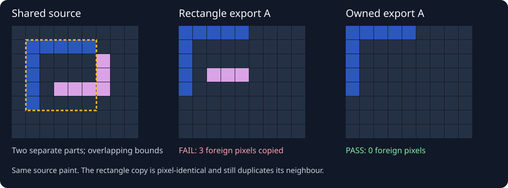

# A pixel-identical crop can carry the wrong part

[Run the anonymous case](../../examples/attachment-ownership/README.md) · [Source preparation skill](../../skills/2d/spine-skeletal/references/source-elements.md) · [Portable audit](../../skills/2d/spine-skeletal/scripts/audit_attachment_ownership.py)

The trigger was a fragment of fur appearing inside a fighter's sleeve after assembly. Isolated image exports were nonempty and matched the original rectangles exactly. Those checks passed because the expected rectangle already contained neighbouring paint.

An isolated-layer render identified the actual contributor: a front-collar export had copied the edge of the rear collar. The two source pieces were separate alpha components, but their bounding rectangles overlapped. Moving the collar's slot or painting over the visible fragment would have left the extraction error intact.

The reusable repair is to declare actual source ownership, preserve each owner's paint and check the complete set of exports. The portable audit pins source bytes, rejects foreign alpha, detects missing and duplicated visible pixels, and verifies native premultiplied paint. Its rejected fixture deliberately passes rectangle equality, so the test cannot be satisfied by the earlier insufficient check.

The public example uses two anonymous L-shaped pieces. A raw rectangle copies three foreign pixels; the owner-only export copies none. The source artwork, threshold and native coordinates stay fixed. No private fighter image is included.

Layering remains a separate problem. A shirt may require an interior behind the upper arm and a front surface above it; the near forearm belongs in front of the shirt. Source-native recomposition does not establish that rotated and filtered surfaces are seam-free. This case proves native export ownership, not a completed character or a playable animation.
