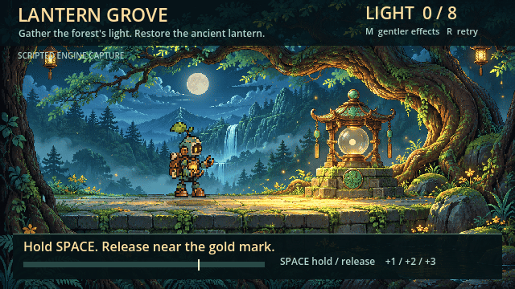

# Lantern Grove: generated art, playable rules, actual engine capture



An original single-screen charge/release game using a GPT-generated courier and a newly generated moonlit forest stage. This is **Godot 4.7.1 rendering a running scene**, not Pillow recreating a proposed game. The capture uses scripted inputs. The project also accepts live keyboard input; no human playthrough or player-comprehension result is claimed.

[Watch with captured sound](docs/gameplay.mp4) · [Reduced-effects capture](docs/reduced.gif) · [Sequence](docs/sequence.png) · [Engine report](docs/engine-report.json) · [Rule report](docs/sim-report.json)

## Run and play

Requires Godot 4 with GDScript; verified on 4.7.1 macOS. Python/Pillow/numpy and FFmpeg are only needed for evidence processing, not live play.

```sh
godot --headless --path examples/lantern-grove --editor --import --quit
godot --path examples/lantern-grove
```

Hold **Space** to gather, release to bank light, **R** to restart, **M** to toggle optional particles, **Escape** to quit. Reach 8 light. Releasing before 30 charge ticks gives 1, at 30–47 gives 2, and at 48–65 gives 3. Holding to 66 ticks overloads the lantern and ends the run. Recovery lasts 18 ticks. These are this prototype's tuning values at 60 logical ticks/s, not imported universal rules.

## Capabilities actually exercised

| Design lens | Implementation | Evidence |
|---|---|---|
| Meaningful choice | Safer early release versus higher-value late release and overload | Boundary assertions at 1/29/30/47/48/65/66 ticks |
| Immediate acknowledgement | Windup label and pose change on accepted press; blocked recovery press emits a reason | Rule event checks; actual scene shows windup |
| Tension and release | Charge arc, moving light, stronger reward near the deadline | Capture ticks 21–138 and later cycles |
| Follow-through | Short release-pose accent and authored recovery; world continues | Trace checks world-clock progression during the accent |
| Reward and goal | Always-visible light goal; +1/+2/+3 feedback and explicit completion state | Safe +1, brilliant +3, final score 9 against target 8 |
| Failure and fast retry | Overload state, restart prompt, one-tick reset of score and charge | Capture ticks 241 and 261; reset assertion |
| Sound tied to events | Synthesized chime plays on authoritative release events | Movie Maker WAV has nonzero samples and 10 s duration |
| Reduced optional effects | M removes particle accents while preserving labels, poses and rules | Actual normal/reduced engine traces match across all 600 ticks |
| Visual hierarchy | Generated courier over subdued scenery, high-contrast goal and warnings | Real rendered sequence; no human readability study |
| Evidence-led review | Exact artifacts, source hashes, driver and untested scope | Machine-readable report and decisions below |

Actor pose accents here are presentation holds, **not combat hitstop**: this game has no hitboxes, damage or collisions. It does not validate a fighting game's contact rules. The reduced mode specifically removes optional particles; it is not a full accessibility certification or a global reduction of every moving element.

## Generated material and presentation ownership

[Original GPT courier](assets/courier-source.png) was generated for this case on 2026-11-15 with a transparent background, one idle pose, teal/copper palette and readable silhouette. The source was alpha-bounds cropped and nearest-resized to fit 58×74 in `courier.png`. The source is retained, so rerunning does not require another generation. `grove-source.png` is the newly generated moonlit forest stage, nearest-resized to 640×360 as `grove.png`. Its compositional brief specifies a quiet left-center character stage, right-center lantern shrine, stone terrace, cool distant waterfall and warm focal lighting. The character feet and animated light are placed against those scene landmarks. The background is one painted layer: its visible depth is not runtime parallax or dynamic haze. `tree.png` retains the earlier normalized GPT oak as provenance but is not drawn in this revised scene. The chime is an original synthesized two-note WAV. No external repository assets are used.

`sim.gd` owns charge, recovery, rewards, loss/win and retry. `main.gd` consumes events to draw sprites, labels, the release pose and bounded particles. The trace records the logical snapshot before rendering. Optional effects never change rewards. The generated forest is static scenery in this case, not evidence of the full wind/parallax extensions. A small required light stream connects the gathering character to the actual shrine; optional firefly motes and release sparks are removed by reduced-effects mode.

## Reproduce rule tests and capture

```sh
godot --headless --path examples/lantern-grove --script test_sim.gd
mkdir -p /tmp/lantern-capture /tmp/lantern-reduced
godot --path examples/lantern-grove --write-movie /tmp/lantern-capture/frame.png --fixed-fps 60 --quit-after 600 -- --demo
godot --path examples/lantern-grove --write-movie /tmp/lantern-reduced/frame.png --fixed-fps 60 --quit-after 600 -- --demo --reduced
ffmpeg -y -framerate 60 -i /tmp/lantern-capture/frame%08d.png -i /tmp/lantern-capture/frame.wav -c:v libx264 -pix_fmt yuv420p -c:a aac -shortest examples/lantern-grove/docs/gameplay.mp4
ffmpeg -y -framerate 60 -i /tmp/lantern-capture/frame%08d.png -vf 'fps=15,split[a][b];[a]palettegen[p];[b][p]paletteuse' examples/lantern-grove/docs/gameplay.gif
ffmpeg -y -framerate 60 -i /tmp/lantern-reduced/frame%08d.png -vf 'fps=15,split[a][b];[a]palettegen[p];[b][p]paletteuse' examples/lantern-grove/docs/reduced.gif
python3 examples/lantern-grove/verify_capture.py /tmp/lantern-capture
```

The script verifies decoded GIF duration, 600 actual image frames, nonzero captured audio, identical logical traces, reduced-particle exclusion and completion. Movie Maker fixes capture timing, so its rendering-time output is **not** a natural frame-pacing benchmark. Headless rule tests contain 2,413 assertions, many repeated across ticks; that is not 2,413 independent scenarios. The presentation no-mutation loop does not simulate real 30/60/120 Hz engine runs.

## Coverage of the larger design framework

The [14-topic reference](../../skills/references/game-design-lenses.md) covers the complete upstream topic structure; its [pinned source inventory](../../skills/references/design-source-index.json) accounts for all 257 summary IDs. This runnable slice demonstrates selected runtime lenses, while the following project documents exercise production-oriented outputs:

- **Decision documents:** [slice, visual revision, collaboration, publicity and retrospective](DECISIONS.md).
- **Concept/specification:** `slice_id=lantern-grove`, revision 1; one timed decision, one goal, explicit failure/retry; desktop keyboard; no combat, inventory or progression system. Parameters and units are above and in `sim.gd`.
- **Team/decision:** one editing agent; no independent playtester. Keep the risk/reward loop; defer additional enemy systems because they do not test this slice's question.
- **Publicity:** permitted claim: “playable generated-art Godot prototype with scripted engine evidence.” Do not advertise human-proven fun, mobile support, combat hitstop or production readiness. The MP4 and GIF show the implemented build.
- **Mindset/retrospective:** prior static art and numerical-only output did not establish an implemented game. This case corrects that evidence gap by recording the actual engine. Next useful review is an uninstructed player session, not more particle layers.
- **Miscellaneous/context:** anecdotes and personal methods remain optional prompts, never project requirements. No attempt is made to impersonate the source creator or infer his endorsement.

**Not-run:** human onboarding/comprehension, live keyboard usability playtest, device/input matrix beyond desktop keyboard design, real-time frame pacing, and most individual original-video techniques. All 14 themes being integrated does not mean all 257 upstream summaries or original videos have been independently verified or implemented in this one game.

## Later pixel-rig revision

The earlier sprite normalization and fractional draw sizes soften pixel details despite nearest filtering. The [Canvas pixel-rig lab](../pixel-rig-lab/README.md) documents that diagnosis and demonstrates independent parts, fixed native sizes, a sharpness comparison and exact integer presentation without Godot. This older capture remains evidence for its rule loop, not the corrected pixel-rig output.
