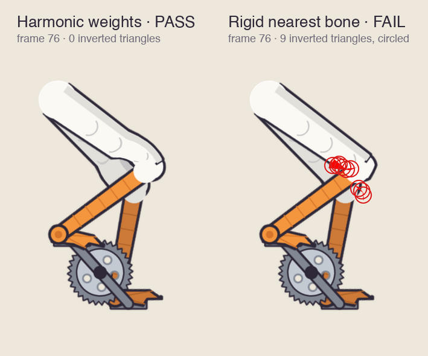
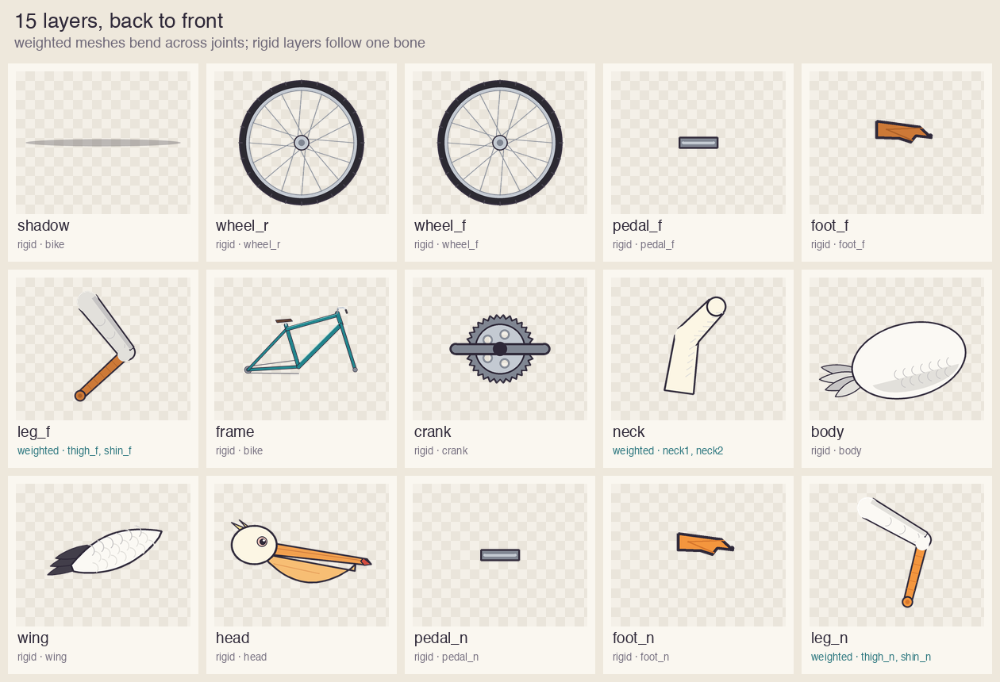
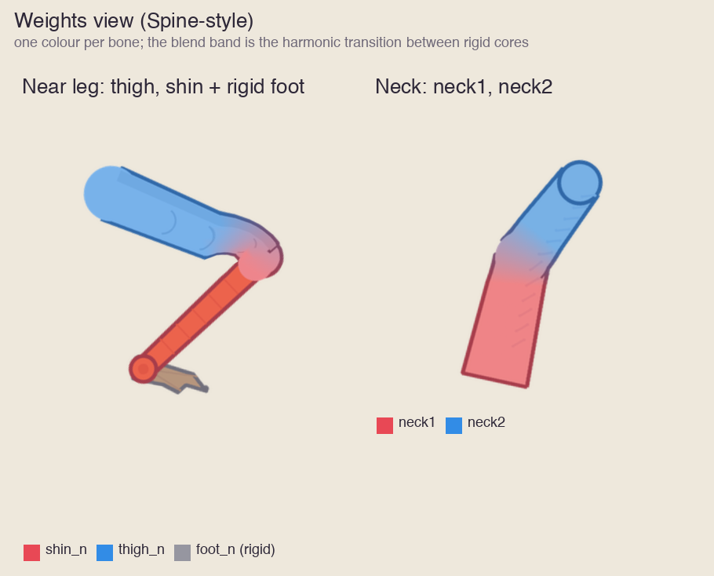

# Pelican on a bicycle: skin weights under IK

<p align="center">
  
</p>

<p align="center">
  <a href="README.zh.md">简体中文</a> ·
  <a href="../../skills/2d/skin-weights/SKILL.md">skin-weights Skill</a> ·
  <a href="../../skills/2d/spine-skeletal/SKILL.md">spine-skeletal audit</a>
</p>

A layered pelican pedals a bicycle. Each leg is one painted mesh, a feathered thigh and a scaly shin, driven by two-bone IK to a pedal on a rotating crank. The webbed foot is a rigid layer hinged at the ankle. The neck is a two-bone mesh. Everything else is rigid. All 15 layers come from a deterministic generator in this folder, so the case needs no downloads, no paid editor and no game assets.

The case runs the whole [skin-weights](../../skills/2d/skin-weights/SKILL.md) pipeline. It also shows the two ways weights go wrong: folding and rubber-bending.

## Run it

```sh
python -m pip install -r requirements-dev.txt
python examples/pelican-bicycle/run.py --out /tmp/pelican-review
python examples/pelican-bicycle/make_figures.py --run /tmp/pelican-review   # optional: rebuild docs/
```

`run.py` exits 0 only when both expected outcomes are reproduced. The output folder holds every report, both traces, GIFs and contact sheets for visual review.

| Step | Script | Output |
|---|---|---|
| Paint layers, rig and motion | `make_art.py` | `source/` (15 PNG layers, `rig.json`, `motion.json`) |
| Alpha-covering, outline-first meshes | `build_mesh.py` | `mesh.json` |
| Harmonic weights and a rigid control | `solve_weights.py` | `harmonic.weights.json`, `nearest.weights.json` |
| Static lint | `lint_weights.py` | `*.lint.json` |
| IK pedalling trace, 121 samples at 60 Hz | `pose_trace.py` | `*.trace.json`, `*.pose.json` |
| Fold audit and surface strain | spine-skeletal `audit_skin.py`, `measure_surface.py` | `*.audit.json`, `*.surface.json` |
| Fixed-camera review | `render_skin.py` | `*.gif`, `*.sheet.png` |

## Results

| Weights | Lint | Fold audit | Visible fold pixels | Shin soft length (near / far) |
|---|---|---|---|---|
| Harmonic, declared per-bone cores | PASS | PASS | 0 | 0.05 / 0.10 |
| Rigid nearest-bone control | FAIL | FAIL | 198 near, 164 far | 0 (it never bends; it folds) |

Both ankles stay on their pedals within 2e-14 world units over the whole cycle. The near knee swings 48° to 114°. The near leg's smallest triangle keeps 38% of its setup area.



## What each figure shows

**Layers.** Each element is its own image, listed back to front. Weighted meshes are labelled with their bones; rigid layers follow one bone. The ankle knob is painted on the leg so the foot can rotate under it without a visible seam.



**Weights view.** One colour per bone, as in Spine's weights view. The blend band is the harmonic transition between the rigid cores. On the leg it sits at the end of the thigh, under the knee cap; the shin is a single colour from just below the knee.



## Lessons this case encodes

- **A pass can still look wrong.** An earlier draft kept the foot inside the leg mesh with symmetric 30% insets. It passed the fold audit with no fold, but the thin shin curved like rubber into the ankle. The fix has two parts. The foot became a rigid layer under a painted ankle knob, and the knee transition moved into the thigh with asymmetric insets. `pose_trace.py` now reports each bone's `softLengthFraction` so this is measured.
- **Seams are caught before motion.** With one handle radius for every leg bone, the shin and foot rigid zones touched and the audit found a fold at that ankle. The seam lint now rejects that configuration without running any motion.
- **The control proves the check.** The same mesh with rigid nearest-bone weights folds at both knees and is rejected by lint and audit.
- **Export is verified, not assumed.** `export_rigc.py --verify-rigc` compiled this rig with rig-c 2.79.0 and posed it with rig-c's own core. Every vertex of every layer matched this evaluator within 2e-5 world units over 121 samples. IK is baked into keys in that export. The official Spine editor/parser round trip was not run.

## Scope

This is a technical deformation case. It does not approve character design, anatomy, gameplay timing or a target runtime. The reference evaluator is not the shipping runtime; a game still exports its own trace for final evidence. All art is generated by repository code under the repository MIT licence.
