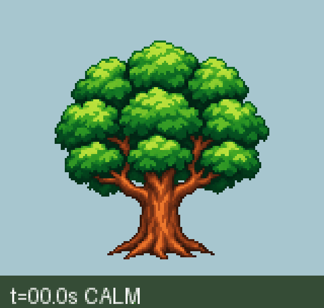
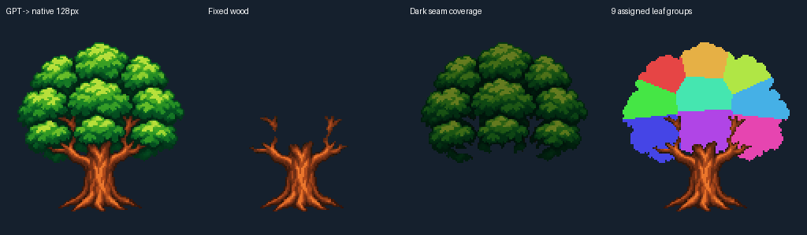
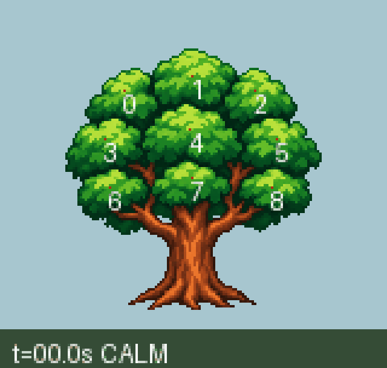
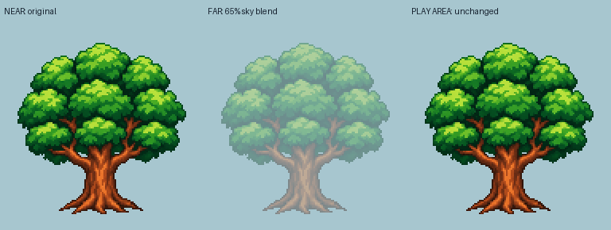

# GPT tree → actual layered wind animation



GPT generated the [transparent source tree](docs/gpt-tree-source.png). The committed renderer actually splits that image and animates its pixels. This is a 12-second, 120-frame Pillow render, not an imagined contact sheet or game-engine recording.

## Reproduce from the committed GPT material

```sh
python3 -m pip install -r requirements-dev.txt
python3 examples/pixel-foliage/animate_generated.py
python3 -m unittest discover -s examples/pixel-foliage -p 'test_*.py' -v
```

Generation is not required to rerun. Source generation requested a single transparent oak, thick brown wood, nine green foliage masses, dark green seams, no ground or text. Colors distinguish wood from foliage. The script normalizes the source to 128×128 with nearest sampling and thresholds alpha at 128. Exact reconstruction refers to that normalized input, not the raw GPT image. Source generation is nondeterministic; committed asset processing is reproducible.

## 1. Ownership and layer reconstruction



A green-color mask identifies foliage. Nine manually selected centers assign foliage by nearest-center distance. This is an explicit, source-specific partition, not a general automatic semantic segmenter. The [layer directory](docs/layers/) contains native.png, wood.png, inside.png and nine registered leaf PNGs on the same canvas. Darkened foliage behind moving groups prevents seams from exposing the background. The fixed interior preserves the original outline, so it is a conservative fill, not reconstruction of hidden branches.

**Checks:** composited rest pose equals normalized source byte-for-byte; roots below row 92 stay identical across all frames; no originally opaque pixel becomes transparent; moving group bounds remain on canvas.

## 2. Stepped wind, traveling gust and spring response



Yellow vertical line: gust center traveling at 65 logical pixels/second. White IDs: nine leaf groups. Red vectors: displacement magnified four times for inspection. The finite gust has a 75-pixel half-width, followed by calm. Outer groups respond more than central ones. Canopy response uses a damped spring integrated at a fixed 120 Hz; visible group poses update at 10 Hz and use integer offsets. Wood never receives the spring offset.

The [time trace](docs/gpt-trace.json) records gust strength, canopy lean and every leaf displacement. Maximum axis displacement in this run is 4 pixels. The final composited tree equals the initial resting tree. GIF decoding checks the full 12-second playback duration. The original model tests also cover spatial periodicity, pose holds and spring recovery; they are not an engine FPS audit.

## 3. Pixel-grid presentation

Native 128×128 artwork sits in a 160×152 scene rendered at exactly 4× using nearest sampling. The verification compares the resized pixels against literal 4× block replication. A bilinear resize is deliberately tested and rejected as a negative control. The numerical fixture covers odd window dimensions and explicitly rejects windows smaller than the logical canvas. Browser zoom, device-pixel ratio and engine import settings still require target-platform verification.

## 4. Atmospheric depth on the same GPT material



The far tree blends RGB 65% toward the sky color, preserving alpha. Near and gameplay trees retain original colors. Numerical tests check zero/full blend endpoints and foreground bypass; the rendered comparison uses actual generated-tree pixels. This example uses a constant sky color. Gradient skies, scrolling cropped layers and live parallax are not implemented here.

## Evidence and skill ownership

[Machine-readable image/render checks](docs/gpt-report.json). The renderer fails immediately if its reconstruction, root, hole, clipping, motion, duration, nearest-scale or alpha assertions fail. Seven model tests provide complementary numerical coverage. The zero-hole measurement only covers the original silhouette; it does not establish artistic quality of newly exposed outer edges.

- [pixel-animation](../../skills/2d/pixel-animation/SKILL.md): foliage splitting, stepped motion, grid and timing.
- [materials](../../skills/assets/materials/SKILL.md): background depth color and alpha preservation.

Both skills contain attributed reference notes. No source article artwork or code was copied. The earlier [art-direction sheet](docs/art-direction.png) remains a static prototype; the earlier [procedural fixture](docs/wind.gif) is reproducible via `render.py`. Neither is the material used in the GPT animation above.

Not yet validated: game-engine integration, multiple trees sharing a world wind service, native display sampling, conifer deformation, automated segmentation for arbitrary artwork, or runtime gradient-sky parallax.

## Further tutorials absorbed into the skills

| Tutorial | What the skill now explains | Demonstration status |
|---|---|---|
| [SLYNYRD: Wind Effects](https://www.slynyrd.com/blog/2021/7/16/pixelblog-33-wind-effects) | Detached leaf silhouettes, neighbor-to-neighbor rustle, anchored fabric/hair and suitable wind particles | Tree cluster motion is demonstrated here; secondary effects are documented, not implemented |
| [Crytek / GPU Gems 3: Vegetation Animation](https://developer.nvidia.com/gpugems/gpugems3/part-iii-rendering/chapter-16-vegetation-procedural-animation-and-shading-crysis) | Force/response/detail separation, artist stiffness controls, stable phase metadata and world wind ownership | Single-tree response is demonstrated; multi-source/multi-tree controls remain untested |
| [Godot: 2D Parallax](https://docs.godotengine.org/en/stable/tutorials/2d/2d_parallax.html) | Repeat coverage, origin, zoom-out and split-screen ownership, combined with pixel-grid and haze checks | Adapter guidance only; no Godot capture |

See [wind craft extensions](../../skills/2d/pixel-animation/reference/wind-craft.md) and [Godot adapter notes](../../skills/engines/godot/reference/pixel-parallax.md) for implementation decisions and acceptance tasks. These additions expand the skill instructions without relabeling unrun effects as tested output.
