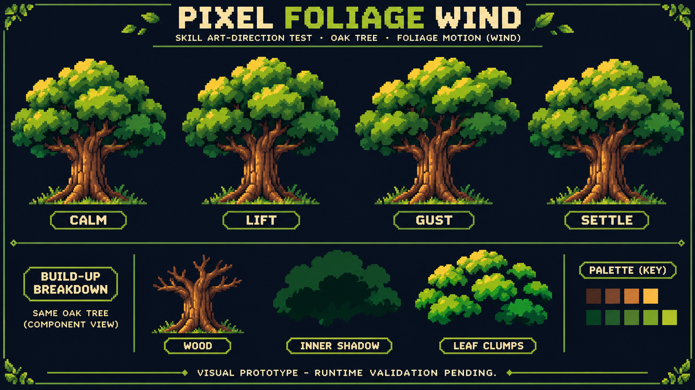

# Pixel foliage: art direction and executable contracts



This case applies [pixel-animation](../../skills/2d/pixel-animation/SKILL.md) and [materials](../../skills/assets/materials/SKILL.md): stepped foliage, pixel-grid presentation and atmospheric depth. See their reference notes for the three SpriteCook source articles and attribution. No article artwork or code is copied.

## Reproduce

```sh
python3 -m unittest discover -s examples/pixel-foliage -p 'test_*.py' -v
```

Python standard library only. Seven tests cover calm/inner-canopy stability, periodic spatial phase, discrete pose holds, render-rate sampling, damped recovery, odd/small viewport behavior, and haze endpoints/alpha/foreground preservation. The fixture uses its own 2-second, 80-pixel wave. A failing periodic-phase check exposed floating-point rounding; normalizing the spatial phase fixed it.

## Image test

Generated with the image generation tool on 2026-11-15. Prompt intent: one oak in CALM / LIFT / GUST / SETTLE poses with a rigid trunk and layered canopy, plus WOOD / INNER SHADOW / LEAF CLUMPS breakdown. The generated sheet is an art-direction prototype: readable foliage masses and subtle pose differences are visible, but trunks and foliage are not verified pixel-identical between panels. The lower panels are illustrations, not exported registered layers. This image is not the input to the numerical tests.

## Scope of evidence

PASS: seven numerical contract tests; repository static skill checks. Visual review: the generated sheet communicates foliage grouping and layered construction. NOT RUN: actual engine playback, sprite splitting, rest reconstruction, hole/cropping detection, physical display pixel-grid audit, runtime gust fields and haze compositing. No playable or production-ready asset claim is made.
