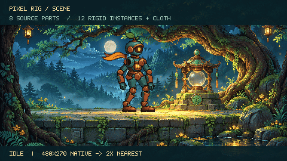
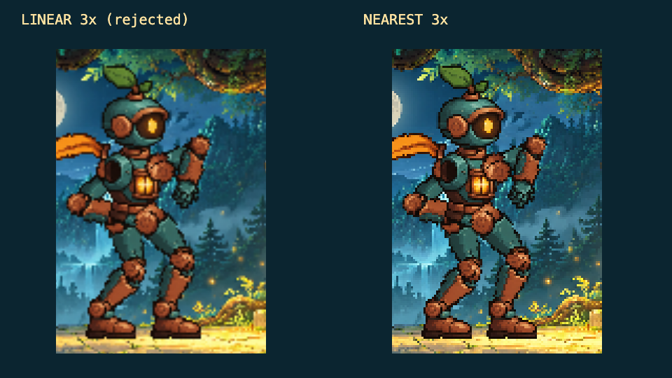
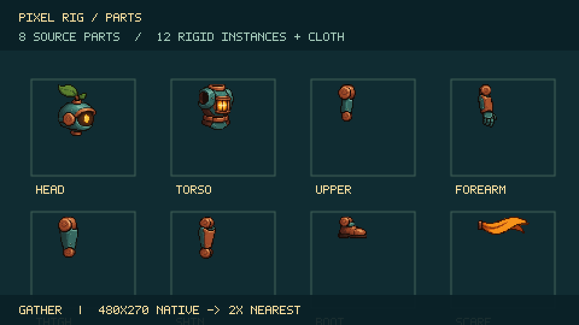
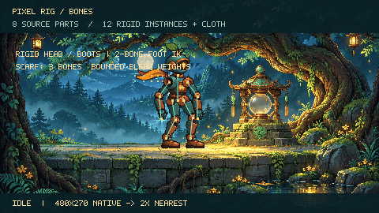

# Pixel Rig Lab: actual split art and Canvas skeletal animation



[Lossless APNG](docs/rig-lossless.png) · [Bone overlay](docs/bones.gif) · [Pose sequence](docs/sequence.png) · [Actual parts](docs/parts.png)

Open **index.html** in Chrome to run the live Canvas demo; no Godot, build tool, npm package or server is required. Buttons switch Scene / Bones + weights / Exploded attachments / Blur comparison, pause and exact 1×/2× display. Native scene labels use an authored 5×7 bitmap font so text inside the pixel grid has no font antialiasing. The page also collects the related wind, depth and design-loop demonstrations. For export, use the Chrome pipe driver below.

The four-second loop is authored as stand → gather inward → reach toward the shrine → release → settle. It is a procedural skeletal animation of actual generated parts, not a sequence of separately generated character drawings. It is not a new playable combat system.

## Why the previous image looked soft

The earlier courier was reduced to about 58×74 and then drawn around 86×110 with continuous scale changes. That is a fractional enlargement before video encoding or browser scaling. The README also requested an 800-pixel display for a 640-pixel GIF. The game had nearest sampling configured, but that alone did not enforce a consistent pixel grid. MP4 chroma compression and viewer zoom can add further loss; the supplied screenshot cannot isolate their exact contribution.

This demo uses a 480×270 logical canvas and a 960×540 presentation canvas. No body region has an animated scale. Textures use nearest sampling; display is an exact integer multiple. Canvas rotation still changes which source texel covers each logical pixel, a deliberate pixel-skeletal style limitation. This is crisp raster sampling, not a guarantee that a rotated pixel contour is identical to hand-redrawn pixel art. Use native PNGs or the 2× view for sharpness judgment; MP4 is a convenience preview. The APNG preserves all 48 captured native RGBA frames byte-for-byte, avoiding GIF palette quantization. README GIFs are shown at their actual 480-pixel width.



## Source preparation and anatomical ownership

GPT generated one transparent eight-cell parts sheet, retained as `assets/parts-source.png`. `prepare.py` applies one shared 256×128 nearest normalization and binary-alpha threshold 128, then exports each nonempty cell's alpha bounds. It never scales individual body parts to fill cells or changes their size during animation. The resulting native dimensions are head 32×43, torso 30×38, upper arm 15×31, forearm/hand 16×36, thigh 17×34, shin 15×35, boot 24×18, scarf 43×15.



| Source part | Semantic ownership / registration | Use |
|---|---|---|
| head | Helmet, eye, antenna and neck cap; pivot (16,41) | One rigid head attachment; small nod, no face deformation |
| torso | Chest lantern and waist; pivot (15,34) | Rigid body, no squash or anisotropic scale |
| upper | Shoulder-to-elbow only; shoulder pivot (7,6), 22-pixel bone | Reused near/far upper-arm instances |
| forearm | Elbow-to-hand; pivot (7,6), 28-pixel bone | Rigid forearm/hand instances |
| thigh | Hip-to-knee; pivot (8,6), 25-pixel bone | Two leg chains |
| shin | Knee-to-ankle; pivot (7,5), 26-pixel bone | Two leg chains |
| boot | Ankle and sole only; pivot (6,5) | Rigid horizontal soles at fixed contacts |
| scarf | Attachment at left, loose cloth to right | Three-bone mesh, authored bounded blending |

Pivots are authored controls, not automatically measured anatomical landmarks. Near/far instances reuse the same view; no turnarounds or hidden-side hand variants are claimed. Circular robot joint caps overlap at shoulders/elbows/knees. The source map and exact exports pass the existing ownership auditor; semantic correctness and transformed seams still need visual review. This is a new character kit, not a claim of pixel identity to the earlier assembled courier.

## Skeleton, IK and weights



Twelve rigid attachment instances use fixed bone lengths. Two-bone IK solves each planted leg, and the hands follow an authored gather/release trajectory. The head and boots remain rigid. The scarf has 18 vertices, 20 triangles and three bones; weights are deliberately authored piecewise blends, **not harmonic solver output**. Vertex overlay colors mix actual bone influence colors. Canvas rasterizes the evaluated scarf triangles with nearest source samples. The rest matrices and posed vertex data are exported by that same runtime.

The setup pose and feet were visually checked against the terrace; fixed ankle targets alone would not establish foot-ground contact. The reported sole-strip check compares actual rendered pixels across every sampled frame. The scene is a painted background, not runtime multilayer parallax.

## Reproduce and test

```sh
python3 -m pip install -r requirements-dev.txt
python3 examples/pixel-rig-lab/prepare.py
node examples/pixel-rig-lab/capture.mjs /tmp/pixel-rig-frames
python3 examples/pixel-rig-lab/audit.py /tmp/pixel-rig-frames
python3 examples/pixel-rig-lab/export_lossless.py /tmp/pixel-rig-frames
```

The driver uses Chrome's DevTools **pipe**, so no HTTP/debug port is opened. It launches an isolated headless Chrome profile, loads the local page, samples the actual Canvas runtime at 12 poses/s and saves PNGs plus evaluated matrices. Set `CHROME_BIN` to the local Chrome executable for another platform. This is deterministic sampled browser rendering, not a real-time FPS or input-latency benchmark.

```sh
ffmpeg -y -framerate 12 -i /tmp/pixel-rig-frames/scene-%03d.png -frames:v 48 -vf 'scale=480:270:flags=neighbor,split[a][b];[a]palettegen[p];[b][p]paletteuse' examples/pixel-rig-lab/docs/rig.gif
ffmpeg -y -framerate 12 -i /tmp/pixel-rig-frames/bones-%03d.png -frames:v 48 -vf 'scale=480:270:flags=neighbor,split[a][b];[a]palettegen[p];[b][p]paletteuse' examples/pixel-rig-lab/docs/bones.gif
```

- [Pixel report](docs/pixel-report.json): exact nearest 2× block replication, identical loop endpoint PNGs, fixed ankle origins and rendered sole strips.
- [Ownership report](docs/ownership-report.json): actual source coverage and exported paint identity.
- [Skin audit](docs/skin-audit.json): existing `spine-skeletal` auditor checks fixed lengths/scales, visible folds, contacts and loops on 49 actual runtime observations. Technical PASS is not anatomical acceptance.
- [Surface report](docs/surface.json): rigid attachment scales remain 1; cloth deformation is measured, not universally accepted by a guessed threshold.
- [Rejected contact control](docs/rejected-contact.json): a deliberately shifted ankle is rejected with the same tolerances.
- [Motion QA](docs/motion-qa.json): default seam/pop/jitter gates and both fixed boots pass. The [earlier failed motion report](docs/motion-qa-before.json) is retained: compressed transitions after long holds caused large single-sample arm steps. The revised continuous eased beat passes with the same defaults, without reset/jitter exemptions.
- [Actual trace](docs/trace.json): matrices, vertices, source hashes, weights and declared checks. Loop endpoints are checked but the repeated endpoint is not encoded as an extra GIF hold.

## Related skill demonstration map

| Skill | Actual demonstration | Boundary |
|---|---|---|
| [pixel-animation](../../skills/2d/pixel-animation/SKILL.md) | Fixed-grid output, 12-pose sampling, explicit phase loop, nearest/linear comparison | No combat hitbox timing claim |
| [spine-skeletal](../../skills/2d/spine-skeletal/SKILL.md) | Split elements, pivots, rigid hierarchy, foot IK and evaluated trace | Canvas equivalent runtime, not a Spine proprietary editor export |
| [skin-weights](../../skills/2d/skin-weights/SKILL.md) | Three-bone weighted scarf and surface evidence | Authored weights; no new harmonic-solver or rig-c round-trip claim |
| [materials](../../skills/assets/materials/SKILL.md) | [Generated-tree depth comparison](../pixel-foliage/docs/gpt-depth.png) | Existing constant-sky offline demonstration |
| pixel-animation foliage | [Actual generated-tree wind animation](../pixel-foliage/docs/gpt-wind.gif) | Separate earlier tree renderer; no false claim it drives this backdrop |
| game-planning / action-feel / game-qa | [Earlier playable charge/release design case](../lantern-grove/README.md) and its actual engine capture | Separate Godot example; this rig needs no Godot |

Not-run: human playtest, independent character art approval, mobile/browser matrix, native Spine editor/compiler, skin-weight harmonic solving for this character, and performance certification. A mechanically green report cannot approve the animation's appeal; assess normal playback and the exposed joints too.
