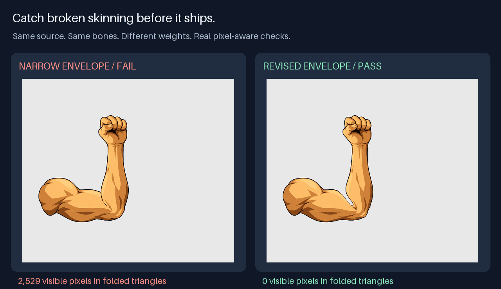

# Weighted skinning you can inspect

[Play the live comparison](https://jammyfu.github.io/open-game-skills/weighted-skinning/) · [Read the Skill](../../skills/2d/spine-skeletal/SKILL.md) · [Field notes](../../docs/cases/weighted-skinning.md)



Two builds use the same 703 vertices, 1,296 triangles, source pixels and fixed bones. Only the elbow weight envelope changes. Both compile successfully; the pixel-aware audit rejects the visible inner-elbow fold in the narrow build.

| Real evaluated sweep | Expected result | Visible source pixels in folded triangles |
|---|---|---|
| Narrow envelope | FAIL | 2,529 |
| Revised envelope | PASS | 0 |

## Reproduce in one command

From the repository root, install the development requirements once, then run:

```sh
python -m pip install -r requirements-dev.txt
python examples/weighted-skinning/run.py --out /tmp/weighted-skin-review
```

The runner decompresses two checked-in runtime traces, verifies source hashes, and executes the **actual installable Skill audit**. Its own exit0 means both expected outcomes were reproduced; the narrow build's report still says FAIL. Each trace has121 poses sampled at60 Hz through a two-second 0° → 90° → 0° joint sweep. Bone length, scale/shear, source UV folds and matrix/vertex loop endpoints are checked. This case declares no foot contacts.

The static live demo needs an ordinary HTTP server and a WebGL-capable browser. It ships its renderer and assets, with no CDN, API key or paid editor requirement. Drag the time slider, enable mesh/bone overlays, and slow the motion to see the difference. The highlighted triangles touch visible ink; CLI pixel counts come from rasterized UV masks against source alpha.

## What is included

- `source/`: AI-generated isolated bare-arm artwork, named rig specs and the exact motion specification.
- `cases/`: gzip-compressed **evaluated** rig-c traces, with portable relative image paths.
- `run.py`: minimal reproducible audit runner; Pillow/numpy only, no game or ROM.
- `rebuild_case.ts`, `make_preview.py`: optional maintainer rebuild from rig-c 2.79.0, its own MIT core and a supported Bun. The compiler's official Spine parser check was not run.
- `demo.ts`, `build_demo.ts`: source for the bundled live PixiJS comparison. Maintainer rebuild also requires PixiJS 8.22.0. No download or global install is performed by these scripts.

```sh
PYTHON=python bun examples/weighted-skinning/rebuild_case.ts /path/to/rig-c-2.79.0
bun examples/weighted-skinning/build_demo.ts /path/to/rig-c-2.79.0 /path/to/pixi.js-8.22.0
```

The same generic limb originated as a technical study in a React+PixiJS fighting-game remake. This redistributable case includes no ROM bytes, ripped tiles, character face or full-character game assets. Artwork/provenance and evidence scope are recorded in [provenance.json](provenance.json). Repository-authored source and example artwork use the repository MIT licence; bundled third-party notices are kept beside the demo.

A technical PASS is deliberately bounded: it does not approve a whole character's anatomy, head/body identity, attachment swaps, original-game action timing, gameplay or an agent's overall quality. The workflow asks for those independent reviews before publication.

## Check surface strain separately

A fold-free mesh can still stretch or nearly collapse. After the runner above, inspect the same real trace with:

```sh
python skills/2d/spine-skeletal/scripts/measure_surface.py /tmp/weighted-skin-review/current.trace.json --out /tmp/weighted-skin-review/current.surface.json
```

The result is `MEASURED-NOT-ACCEPTED`: local principal scales, signed area ratios and source-pixel-weighted tails. Unit bone scales, constant triangle area or zero folds do not establish natural anatomy. Review region/view-specific bounds and the actual pixels; use rigid limb cores, painted joint overlap or corrective views when a broad weight envelope makes the limb rubbery.
