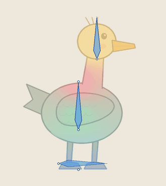
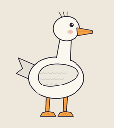

# Whole-figure idle: one image, no cut parts

  
  

<a href="README.zh.md">简体中文</a> · <a href="../../skills/2d/skin-weights/SKILL.md">skin-weights Skill</a>

A small idle does not need a character cut into parts. This case animates **one painted image** of a duck with bones and skin weights: the chest breathes, the body leans a little and the head follows late. The feet stay planted and the head never deforms. Nothing is cut, so there are no seams at the neck, wing or legs.

## Run it

    python -m pip install -r requirements-dev.txt
    python examples/whole-figure-idle/run.py --out /tmp/duck-idle

`run.py` exits 0 only when every expected outcome below is reproduced.

| Step | Script | What it does |
|---|---|---|
| Paint | `make_art.py` | One RGBA duck, `source/duck.png` |
| Measure once | `measure_anatomy.py` | Finds the body axis, the neck bottleneck, torso width, the tail as an appendage and the foot band; proposes the rig |
| Idle | `idle_motion.py` + `idle.json` | Two eased breaths in 4 s; the spine lags the chest and the head lags further |
| Weights and checks | `build_mesh.py` → `solve_weights.py` → `lint_weights.py` → `pose_trace.py` → `audit_skin.py` + `measure_surface.py` | The usual skin-weights pipeline |
| Motion | `motion_qa.py` | Loop seam, pops, jitter |

## What the rig is

`measure_anatomy.py` measures the silhouette once on the setup image and freezes it. Re-measuring per frame is how generated idles shimmer. From the alpha it proposes five bones:

- **ground**: a bar across both feet, never animated, checked as a fixed contact.
- **spine**: from the hips to the chest, so the body can lean.
- **chest**: a zero-length bone whose disc handle breathes up and down.
- **head**: a rigid core from the neck line to the crown, so the face never stretches.

The neck between the chest and the head is the only soft band. When a silhouette has no neck bottleneck, the script stops and asks for `--neck-row` instead of guessing.

## The idle

All three channels share one breath curve. It rises over the first 40% of a breath, settles over the rest, and is eased at both ends. Two whole breaths fill the 4 s loop, and phase 0 is the setup pose, so the wrap is invisible.

## Results

| Check | Result |
|---|---|
| Lint, fold audit | PASS, 0 visible fold pixels |
| Surface | the smallest triangle keeps 92% of its area; P05/P95 principal scale 0.98 / 1.03 |
| Motion QA | PASS: seam 0.53x the busiest frame elsewhere, largest step 1.6x the median, 0% direction reversals |
| Control: 2.5 breaths per loop | REFUSED before any motion is written |
| Control: random head jitter | FAIL: 54% of samples reverse direction |

 The jittered control. Every fold and length check still passes; motion QA rejects it.

## Scope

This is a technical case for a small idle. It does not approve the character design, and it does not cover large poses, which need layered parts or redrawn frames (see the [spine-skeletal](../../skills/2d/spine-skeletal/SKILL.md) mode table). The breath curve, measuring anatomy once and judging motion as motion follow [sprite-gen](https://github.com/aldegad/sprite-gen) (Apache-2.0). This is an independent implementation with bones and skin weights. Art is generated by repository code under the repository's MIT licence.
