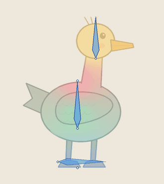
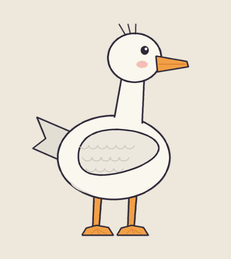

# 整图待机：一张图，不拆件

  
  

<a href="README.md">English</a> · <a href="../../skills/2d/skin-weights/SKILL.md">skin-weights Skill</a>

小幅度的待机动作不需要把角色拆成零件。这个案例用骨骼和蒙皮权重驱动**一整张**鸭子图：胸口呼吸，身体轻微前倾，头稍晚跟上。脚一直踩稳，头部从不变形。因为什么都没拆，脖子、翅膀和腿上都没有接缝。

## 运行

    python -m pip install -r requirements-dev.txt
    python examples/whole-figure-idle/run.py --out /tmp/duck-idle

只有下面每一项预期结果都复现时，`run.py` 才以 0 退出。

| 步骤 | 脚本 | 作用 |
|---|---|---|
| 绘制 | `make_art.py` | 一张 RGBA 鸭子图，`source/duck.png` |
| 只测一次 | `measure_anatomy.py` | 找出身体中轴、颈部瓶颈、躯干宽度、作为附肢的尾巴和脚部区域，并提出骨架 |
| 待机 | `idle_motion.py` + `idle.json` | 4 秒内两次平滑呼吸；脊柱比胸口晚，头更晚 |
| 权重与检查 | `build_mesh.py` → `solve_weights.py` → `lint_weights.py` → `pose_trace.py` → `audit_skin.py` + `measure_surface.py` | 常规的 skin-weights 流程 |
| 动作 | `motion_qa.py` | 循环接缝、跳帧、抖动 |

## 骨架是怎么来的

`measure_anatomy.py` 只在装配图上测一次轮廓并冻结结果。逐帧重测正是生成的待机动画会闪烁的原因。它根据透明度提出五根骨：

- **ground**：横跨两只脚的地面条，从不动画，作为固定接触点检查。
- **spine**：从臀部到胸口，让身体可以前倾。
- **chest**：零长度骨，圆形控制区上下起伏表现呼吸。
- **head**：从颈线到头顶的刚性核心，脸永远不会被拉伸。

胸口和头之间的脖子是唯一的柔软过渡带。如果轮廓没有颈部瓶颈，脚本会停下来要你给出 `--neck-row`，而不是去猜。

## 待机动作

三个通道共用一条呼吸曲线：前 40% 吸气上升，其余时间回落，两端都平滑。4 秒循环正好装下两次完整呼吸，第 0 帧就是装配姿势，所以循环接缝看不出来。

## 结果

| 检查 | 结果 |
|---|---|
| 静态检查、翻折审计 | 通过，可见翻折像素为 0 |
| 表面 | 最小三角形保留 92% 面积；主拉伸 P05/P95 为 0.98 / 1.03 |
| 动作质检 | 通过：接缝处加速度是其他帧最大值的 0.53 倍，最大单步是中位数的 1.6 倍，方向反转 0% |
| 对照组：每个循环 2.5 次呼吸 | 在写出任何动作前就被拒绝 |
| 对照组：头部随机抖动 | 失败：54% 的采样帧反转方向 |

 抖动对照组。所有翻折和长度检查仍然通过，但动作质检拒绝了它。

## 范围

这是一个小幅度待机的技术案例，不代表角色设计已经验收，也不覆盖大幅度姿势；大幅度姿势需要拆件或重绘帧，见 [spine-skeletal](../../skills/2d/spine-skeletal/SKILL.md) 的模式表。呼吸曲线、只测一次解剖结构、把动作当动作来审，这些思路来自 [sprite-gen](https://github.com/aldegad/sprite-gen)（Apache-2.0）。这里是用骨骼和蒙皮权重独立实现的。素材由仓库代码生成，采用仓库的 MIT 许可证。
