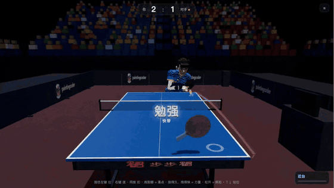

# Racket sports feel

This skill **owns ball flight, ball/surface/racket contact response, the mapping from a simple input to a stroke motion, and the assist knobs**. [input-design](../input-design/SKILL.md) owns the semantic action grammar and rebinding; [browser-input](../browser-input/SKILL.md) owns pointer/touch capture; [audio-feel](../audio-feel/SKILL.md) and [juice-vfx](../juice-vfx/SKILL.md) own feedback layering; [difficulty-design](../difficulty-design/SKILL.md) owns the difficulty curve that picks assist values. Rally legality and scoring are a small pure rules module the project owns and tests; this skill consumes its events, it does not hide rules inside the physics.

## Modes

| Mode | What the player controls | What the game solves |
|---|---|---|
| spin-assist | racket position plus swing direction and speed at contact, which select a stroke motion | face angle toward a target, reading a declared fraction of the incoming spin |
| free-face | racket position, swing and an explicit face angle (tilt, offset or second stick) | nothing on the player side; the solver serves the opponent and the hints only |
| arcade-aim | a target point and a stroke type | the launch only; flight still uses drag/Magnus, but contact is not simulated |
| button-charge | movement, one button per spin family pressed **before** the ball arrives (hold to charge), and an aim reticle | when to swing (auto-swing), the last step into position, and the face angle through the same contact model |
| prejudge-stick | a depth zone and strafing, a press that reads the spin and plants a virtual stick, a drag that aims, a release that swings | the technique from button × position, the last step into position, and the face angle through the same contact model |

Hybrids are valid when the project names which pieces it takes. Example: spin-assist on easy, free-face on expert, with a racket-offset face lever in between.

A request to make it "feel like" a named sports game takes genre-level mechanics only: press-early auto-swing, button-per-spin, charge, a slow-move penalty while charging, chance zones. It never takes characters, names, art, music or courts.

## Simulation contract

Use SI units and one authoritative ball integrator on the project's fixed substep. A ping-pong ball needs roughly 1/1000 s or finer for stable contact. Do not tie the substep to the render rate. The ball state is position, velocity and angular velocity. Air force is drag plus Magnus `k (ω × v)`, and spin decays slowly. Every contact (table, racket, floor) is one impulse model: normal restitution plus Coulomb friction capped at the rolling condition. That one model already makes topspin skid long, backspin check short, and incoming spin deflect a return. Do not author those effects separately.

Player, opponent, prediction and the face solver all call the same functions. The solver may use a coarser step only if it then targets a margin (net clearance, distance from the end line) that covers the step difference. The opponent works in a mirrored frame: a 180° rotation about the vertical axis applied to position, velocity and angular velocity. Do not keep a second, hand-flipped physics.

## Rules

1. **A stroke is a racket motion, not an outcome.** It is a forward push plus brush along the face (up/down and sideways). The face angle is solved toward a target. Never write outgoing velocity or spin directly. If you do, topspin no longer flies long and backspin no longer nets, and the sport's reading game disappears.
2. **Assists remove reading, not physics.** Typical knobs: the fraction of incoming spin the face solve "knows" (the player's own brush is always known), effective reach, automatic footwork in depth, automatic height, and solving the serve's placement. Each knob is visible and declared per difficulty, and none of them changes the integrator or the contact coefficients.
3. **When the assist reads less than all of the spin, give the player a learnable lever.** Example: racket below the ball opens the face, above it closes it, beside it turns it. Read the lever from the hand's intended position at the contact substep, not from the smoothed rendered racket or the swing path's midpoint. Add an optional hint showing where the racket must go, computed by scanning the real shot's landing window rather than from an angle formula. Measure the real tolerance first: fast strokes often have a 2–4° face window, which is far below what raw pointer aiming can deliver.
4. **Choose the solver's branch on purpose.** Landing depth versus face pitch is not monotonic: there is a flat branch and a moon-ball branch. Scan pitch coarsely, then refine. Reject flights over a time cap, require a net-clearance margin, move the target deeper when a low fast ball cannot clear the net, and absorb pace (scale push down) before falling back to an unsafe best effort.
5. **The opponent plays under the same constraints.** It predicts the ball, picks a contact point with a style score (an attacker near the table at 25–45 cm above it; a chopper far back, low and descending), moves with speed and reaction caps, and hits by time rather than by a plane crossing, because nearly vertical balls never cross the plane. It chooses strokes from the same table as the player, misreads spin by a level-scaled error, and gets face noise in degrees sized to the measured windows.
6. **Make spin visible and audible without letting presentation change logic.** Use a textured ball shown at a fraction of its true rotation (true spin aliases at 60 fps), a blob shadow on the surface below for depth, a trail colored by the spin relative to the ball's own flight (so color tells the receiver which button to press), synthesized contact sounds with a brush layer that scales with friction, and a short camera kick on smashes only.
7. **Teach from the failure.** After a lost point, connect the error to the incoming spin and the stroke used ("backspin plus a flat hit means net"). Feedback text reads the logged contact; it never guesses.

8. **In button-charge mode, the button picks a spin family and the position picks the technique.** Left (top) is a drive near the table and a loop from mid or far. Right (back) is a push near, a long push mid, and a chop far. The ball's height and whether contact is over the table refine the choice further. The physics still punishes the wrong family: a flat hit or block against backspin goes into the net.
9. **Animated players only sell the contact.** Logic decides the hit. Visually:
   - Before the swing, pull the root to `contact − clip blade offset`.
   - Add an arm IK pass around the contact frame.
   - Read clip contact times and blade offsets from exported metadata, not by eye.

   A first-person side hides the body by its material, not its node, because the racket hangs from a bone under the body node.
10. **In prejudge-stick mode, each input means one thing and one gesture makes one shot.** The button is the read, stick direction is the line, stick distance is the depth, hold time plus drag speed is the power, and the release is the swing. Do not let one number drive two outcomes: when distance set both depth and power, a hard short ball was impossible. A swing that contradicts the read, or starts too far from position, becomes a high lob instead of a hidden assist.
11. **Sidespin follows the swing, and it must be seen.** Model the racket wrapping around the outside of the ball so the ball curves toward the swing. Keep the on-screen racket moving in the swing direction. Any lateral exaggeration lives in the shared integrator and applies to every ball, for both sides.

## Depth

The [table-tennis kit](references/table-tennis-kit.md) contains the stroke table, coefficient seeds, solver procedure, calibration and self-play numbers, pitfalls found while building one, and a reproduction checklist. The [action controls](references/action-controls.md) reference covers:
- the button-charge input grammar, contact selection and commit timing;
- the hit-quality model and the feel-layer numbers;
- the animated-player alignment, the clip-driven serve, and exporting PunchBox players;
- that build's pitfalls;
- the current feel in [section 13](references/action-controls.md#13-virtual-stick-split-aim-and-power-seventh-pass-current-feel): virtual stick, power split, spin colors, sidespin and the tutorial.

The clip is the last 8 s of a 26-shot rally against the normal opponent. A scripted bot played the near side through real mouse events and read the game's predictions, so it shows the input path and the rendering, not human feel.

## Accept

Record the build, substep, coefficients, assist values per difficulty and opponent style. Then, separately:

- Static and unit checks: rules legality (serve, double bounce, net, own side, out, scoring, serve rotation), the solver reaching its target, and the mirrored opponent hitting back toward the player.
- A calibration matrix: every stroke against topspin, backspin, heavy chop, sidespin and a high ball, with full and zero spin read. The physics should reproduce the sport's known failures.
- Headless self-play statistics for each difficulty and opponent style (shots per point, error reasons).
- A browser bot that drives the real input path. Label it debug-assisted: it reads predictions. Label any clip recorded from it the same way.
- A human playtest of feel. Mark it `not-run` until a person has played.

Do not call a difficulty fair from bot statistics alone.
